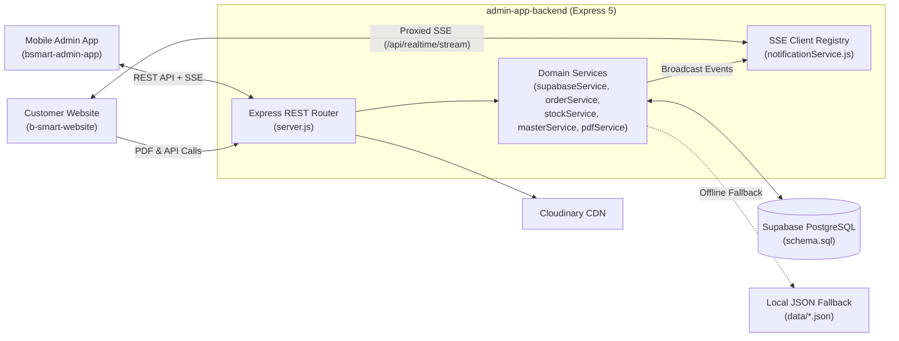

<div align="center">
  
  <h1>B'Smart Admin Backend — Real-Time API, SSE &amp; PDF Engine (<code>admin-app-backend</code>)</h1>
  <p>
    <strong>Node.js &amp; Express 5 backend powering B'Smart Dresses catalog/master CRUD, size-level inventory management, Server-Sent Events (SSE) broadcasting, Cloudinary AI image uploads, and PDFKit order invoicing.</strong>
  </p>

  <p>
    
    
    
    
    
  </p>
</div>

---

## Table of Contents

- [About the Project](#about-the-project)
- [Key Features](#key-features)
- [Tech Stack](#tech-stack)
- [System Design & Architecture](#system-design--architecture)
- [Database Schema Overview](#database-schema-overview)
- [Project Structure](#project-structure)
- [API Endpoints](#api-endpoints)
- [Environment Variables](#environment-variables)
- [Getting Started](#getting-started)
- [Security & Privacy Notes](#security--privacy-notes)

---

## About the Project

`admin-app-backend` is the central Node.js/Express service in the **B'Smart Dresses** ecosystem, bridging the Expo mobile admin app (`bsmart-admin-app`), the Next.js customer storefront (`b-smart-website`), **Supabase PostgreSQL**, and **Cloudinary**:

- **Real-Time Event Hub**: Maintains active Server-Sent Events (SSE) connections (`/api/realtime/stream`) to push live `order_created`, `order_updated`, `order_completed`, `order_deleted`, `notification`, and `shop_status_updated` events.
- **Transactional Order & Stock Engine**: Validates orders, adjusts size-level stock (`size_stocks`), restores inventory on cancellation, and generates formatted PDF order invoices via `PDFKit`.
- **Resilient Master & Status Persistence**: Synchronizes schools, classes, categories, and store delivery closure state (`sys_shop_status`) with optimistic timestamp concurrency guards and local JSON fallbacks.

---

## Key Features

- **Server-Sent Events (SSE) Real-Time Broadcaster**
  - Streams live events over `/api/realtime/stream` to both web visitors (proxied via Next.js) and the mobile admin client.
- **Store Delivery Closure API (`/api/shop-status`)**
  - Reads and upserts `sys_shop_status` in Supabase with automatic expiration detection, `no-store` cache headers, and optimistic `updatedAt` checks so stale mirror writes never overwrite newer toggles.
- **Order Lifecycle & PDF Invoice Generation**
  - Full order pipeline (`pending`, `accepted`, `declined`, `completed`, `cancelled`) with customer/admin notifications and on-demand PDF invoice streaming (`GET /api/orders/:id/pdf`).
- **Size-Level Stock Management (`stockService`)**
  - Deducts and restores inventory per garment size (`size_stocks`) while syncing aggregate `stock_quantity` and `in_stock` flags.
- **Cloudinary Media Upload (`POST /api/upload`)**
  - Supports image upload with automatic Cloudinary AI background removal (`background_removal: 'cloudinary_ai'`) and graceful fallback to standard upload.
- **Dynamic Masters & Cascading Updates (`masterService`)**
  - CRUD operations for Schools, Classes, and Categories with cascading renames across existing products and soft-delete tracking.

---

## Tech Stack

<p align="left">
  
  
  
  
  
  
  
</p>

| Layer | Icon & Technology | Purpose |
| --- | --- | --- |
| **Runtime & Server** |   | REST API routing, CORS handling, and long-lived SSE streaming |
| **Database** |   | Persistent storage for `products`, `orders`, `notifications`, and master tables |
| **Media Pipeline** |  | Product image hosting & AI background removal |
| **Document Engine** |  | Dynamic order invoice & receipt PDF generation |
| **Config** |  | Environment variable loading |

---

## System Design & Architecture



### Real-Time & Concurrency Safeguards

1. **Optimistic Timestamp Guard (`saveShopStatusToSupabase`)**: Before upserting `sys_shop_status`, the backend queries the persisted row's `updatedAt` timestamp and ignores stale mirror writes whose `updatedAt` is older, preventing out-of-order overwrites.
2. **No-Store Caching**: `/api/shop-status` responses emit `Cache-Control: no-store, no-cache, must-revalidate, proxy-revalidate` so proxies and mobile HTTP stacks never serve stale status.
3. **Graceful Local Fallback**: Master lists (`schools.json`, `classes.json`, `categories.json`) and `products.json` provide resilience if Supabase is temporarily unreachable.

---

## Database Schema Overview

Defined in [`schema.sql`](./schema.sql) (with Row Level Security policies, `REPLICA IDENTITY FULL`, and `supabase_realtime` publication enabled):

| Table | Primary Key | Purpose |
| --- | --- | --- |
| `public.products` | `id (TEXT)` | Uniform catalog, category/school/class mapping, `size_prices`, `size_stocks`, and stock flags |
| `public.orders` | `id (TEXT)` | Customer orders, `delivery_address` JSONB, line items, status, delivery window, and timestamps |
| `public.notifications` | `id (TEXT)` | Customer/admin notifications plus system config rows (`sys_shop_status`, `sys_master_registry`) |
| `public.schools`, `categories`, `classes` | `id (TEXT)` | Optional normalized master lookup tables |

---

## Project Structure

```text
admin-app-backend/
├── server.js                           # Express 5 entry point, CORS, REST endpoints & server startup
├── index.js                            # Alternative/bootstrap entry
├── schema.sql                          # PostgreSQL DDL, RLS policies, Replica Identity & Realtime publication
├── package.json                        # Dependencies & start script
├── config/
│   ├── supabase.js                     # Supabase client initialization
│   └── cloudinary.js                   # Cloudinary SDK configuration
├── services/
│   ├── supabaseService.js              # Product CRUD & shop-status persistence + timestamp guards
│   ├── orderService.js                 # Order creation, status transitions, cancellation & stock sync
│   ├── stockService.js                 # Size-level inventory deduction & restoration
│   ├── masterService.js                # Schools, classes & categories CRUD + cascading updates
│   ├── notificationService.js          # Notification persistence & SSE client broadcasting
│   └── pdfService.js                   # PDFKit order invoice generator
├── data/                               # Local JSON fallback stores & soft-delete registries
└── test_order_system.js                # Order system verification script
```

---

## API Endpoints

| Category | Endpoints |
| --- | --- |
| **Health & Config** | `GET /`, `GET /api/config` |
| **Media Upload** | `POST /api/upload` |
| **Products** | `GET /api/products`, `GET /api/products/:id`, `POST /api/products`, `PUT /api/products/:id`, `DELETE /api/products/:id` |
| **Orders & Invoices** | `GET /api/orders`, `GET /api/orders/:id`, `POST /api/orders`, `GET /api/orders/:id/pdf`, `PUT /api/orders/:id/status`, `PUT /api/orders/:id/complete`, `PUT /api/orders/:id/cancel`, `DELETE /api/orders/:id` |
| **Masters (CRUD)** | `GET/POST/PUT/DELETE` on `/api/categories`, `/api/schools`, `/api/classes` |
| **Notifications & SSE** | `GET /api/realtime/stream`, `GET /api/notifications`, `POST /api/notifications`, `POST /api/notifications/:id/read`, `POST /api/notifications/read-all` |
| **Store Status** | `GET /api/shop-status`, `POST /api/shop-status`, `PUT /api/shop-status` |

---

## Environment Variables

Create a `.env` file in `bsmart-admin-app/backend/admin-app-backend/` using placeholder values (never commit real secrets or API keys):

```env
# Server Port
PORT=5000

# Supabase Configuration
SUPABASE_URL=https://<your-supabase-project>.supabase.co
SUPABASE_KEY=<your-supabase-key>

# Cloudinary Configuration
CLOUDINARY_CLOUD_NAME=<your-cloudinary-cloud-name>
CLOUDINARY_API_KEY=<your-cloudinary-api-key>
CLOUDINARY_API_SECRET=<your-cloudinary-api-secret>
```

---

## Getting Started

### Prerequisites

- **Node.js** `>= 20.x`
- **npm** `>= 10.x`
- A **Supabase** project initialized with [`schema.sql`](./schema.sql) and a **Cloudinary** account.

### Installation & Running Locally

```bash
# 1. Navigate to the backend directory
cd bsmart-admin-app/backend/admin-app-backend

# 2. Install dependencies
npm install

# 3. Configure environment variables in .env (see above)

# 4. Start the Express server
npm start
```

The server listens on `0.0.0.0:${PORT}` (defaults to `3000` if `PORT` is unset in `.env`).

---

## Security & Privacy Notes

- Never commit `.env`, `CLOUDINARY_API_SECRET`, Supabase service-role keys, or private credentials to Git.
- Tighten CORS `allowedOrigins` in `server.js` before restricting production access, and ensure Supabase RLS policies match your production authentication model.
